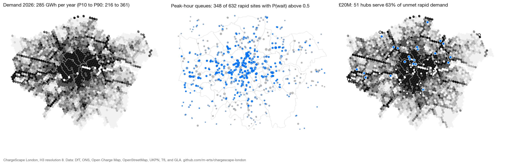
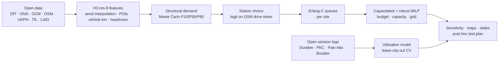

# ChargeScape London

**A spatial decision system for EV charging networks under uncertain demand.**
Where should the next public rapid-charging hubs in Greater London go, how many ports and what power should they have, and how confident can we be? Built end-to-end from open data, with every assumption visible and every number reproducible.

[](https://github.com/m-erts/chargescape-london/actions/workflows/ci.yml)


**[Slides](https://m-erts.github.io/chargescape-london/slides/) · [Слайды на русском](https://m-erts.github.io/chargescape-london/slides/ru.html) · [Interactive maps](https://m-erts.github.io/chargescape-london/maps/) · [Notebooks](https://nbviewer.org/github/m-erts/chargescape-london/tree/main/notebooks/) · [Methodology](docs/methodology.md) · [Architecture & stack](docs/architecture.md) · [Data catalog](docs/data_catalog/README.md)**

<p align="center"></p>

## Why this project

Public charging is an infrastructure business whose economics hinge on **utilisation**: a hub in the wrong hex idles at 5 %, the right one runs above 20–30 % and queues. Operators (EVgo, Allego, Yandex Electro and others) describe site selection as a demand model on dozens to hundreds of factors, yet almost no public project

1. predicts *usage* rather than "where chargers already are",
2. carries uncertainty into the siting decision,
3. accounts for queues and for demand a new site takes from its neighbours, or
4. says how it would be proven wrong.

ChargeScape does all four for London, on a laptop, from open sources.

## What it answers

| Question | Answer in this repository | Notebook |
|---|---|---|
| Where are London's chargers relative to EV owners without driveways? | Supply audit on 13k de-duplicated sites: Moran's I, Getis-Ord Gi* hot spots, drive-time gaps on the road network | [01](notebooks/01_supply_audit.ipynb) |
| How much public energy will each 0.74 km² hex need, now and in 2030? | Structural Monte Carlo demand surface (P10/P50/P90) with a taxi & private-hire layer; UKPN DFES 2030 pathways; checked against observed aggregates | [02](notebooks/02_demand_surface.ipynb) |
| Which sites absorb the demand, and where do queues form? How much of a new hub's demand is new? | Multinomial-logit station choice on drive times, Erlang-C queues per site, new vs cannibalised demand for any candidate | [03](notebooks/03_choice_and_queues.ipynb) |
| Given a budget, where do the next 4 × 150 kW hubs go, and what if the assumptions are wrong? | Capacitated maximal-covering MILP with grid-headroom filter, robust version over demand scenarios, sensitivity to nine changed assumptions | [04](notebooks/04_siting.ipynb) |
| Do context features explain *observed* utilisation anywhere, and does that transfer? | LightGBM on chargers with open session logs in four cities; random vs leave-city-out validation | [05](notebooks/05_utilisation_transfer.ipynb) |

## Headline results (Greater London, H3 resolution 8)

| | Value | Source / status |
|---|---|---|
| Public chargers (DfT, 1 July 2026) | 31,371, of which 2,533 (8.1 %) are 50 kW+ | DfT EVCI · observed |
| Charging sites mapped | | Open Charge Map, OpenStreetMap, NCR 2021 · observed |
| Plug-in cars kept in London (March 2026) | 300k: 177k private-kept, 120k company-kept; 63 % battery-electric | DfT VEH0145 by LSOA · observed |
| Public charging demand 2026 | | structural model on observed inputs |
| Demand 2030 (DFES pathways) | | model + UKPN DFES 2026 |
| Implied rapid sessions per charger per day | | cross-check, notebook 02 |
| Rapid network today | | choice + queue model |
| New hub cannibalisation | | logit with outside option, notebook 03 |
| New hubs, £20M budget | | MILP, notebook 04 |
| Siting sensitivity | | 9 changed assumptions, notebook 04 |
| Context features vs observed utilisation | | LightGBM, notebook 05 · observed target |

Every value above is generated from the committed tables by `make report` (see `reports/tables/key_numbers.json`); nothing is typed in by hand.

## How it works



Design choices that matter (full text in [`docs/methodology.md`](docs/methodology.md), assumptions in [`docs/model_card.md`](docs/model_card.md)):

* **A label on every dataset** — `observed` / `proxy` / `synthetic` — in the [data catalog](docs/data_catalog/README.md) and in the results tables. Nothing synthetic is presented as observed.
* **Demand is modelled, then checked against observed aggregates** (DfT charger counts × TfL occupancy; per-charger throughput in open session logs), because London publishes no charger-level usage.
* **Drive times, not buffers**: igraph shortest paths on the 131k-node OpenStreetMap drive graph — the 2/5/10-minute logic operators actually use.
* **Supply calibrated to official totals**: Open Charge Map, OSM and the 2021 registry are merged and de-duplicated; ports still missing are closed per borough against DfT's 50 kW+ counts (the factor is stored per site).
* **Uncertainty reaches the decision**: the robust MILP picks one set of hubs that performs across P10/P50/P90, and a sensitivity run shows which conclusions survive changed assumptions.
* **Optimality is reported, not assumed**: every MILP records its HiGHS gap.
* **Spatial cross-validation by default**: random K-fold is shown only to expose its optimism.

## Tech stack

| Layer | Tools | Why |
|---|---|---|
| Spatial | H3, GeoPandas, Shapely, pyproj | equal-area hex grid for siting; area-weighted interpolation from census units |
| Network | OSMnx, igraph | many-to-many drive times on the London graph in seconds, no routing server to run |
| Statistics & ML | esda, libpysal, LightGBM, scikit-learn | Moran's I, Gi*, LISA; quantile gradient boosting; leave-group-out CV |
| Optimisation | SciPy `milp` (HiGHS) | sparse capacitated and robust MCLP without a commercial solver |
| Queues & choice | NumPy (own code, unit-tested) | Erlang C, multinomial logit, incremental demand decomposition |
| Delivery | MapLibre GL JS, matplotlib, GitHub Pages | offline-capable web maps, static slides and project page |
| Quality | pytest, ruff, GitHub Actions | tests against closed forms and toy optima; CI on Python 3.11 and 3.12 |

Rationale for each choice, the module map and run times: [`docs/architecture.md`](docs/architecture.md).

## Reproduce

```bash
git clone https://github.com/m-erts/chargescape-london && cd chargescape-london
pip install -e ".[all]"            # or: pip install -r requirements.txt && pip install -e .
```

**Quick path — from the committed tables (no downloads; about an hour, almost all of it the MILPs):**

```bash
make models      # demand Monte Carlo → choice + queues → siting sweep
make report      # key numbers → README table → data catalog index
make maps slides # MapLibre pages and decks in docs/
make notebooks   # regenerate and execute notebooks 01–05
```

**Full rebuild from the original publishers (~4 GB, ~2 h):** `make all`, which runs `make data features` first. Set `OCM_API_KEY` (free key from openchargemap.org) to include Open Charge Map; without it the build falls back to OSM + registry and a larger borough calibration. `make serve` opens the docs site on http://localhost:8000.

## Repository layout

```
src/chargescape/
  data/        one module per source: census, vehicles, chargepoints, osm, transit, traffic, weather, ukpn, sessions_open
  features/    grid (H3, interpolation) · supply · context (LAEI, DFES, headroom) · accessibility & travel_time (igraph)
               spatial_stats · station_context · build
  models/      structural_demand · demand_pipeline · choice (MNL) · queueing (Erlang C) · allocation_pipeline · ml
  optimize/    facility (sparse HiGHS MILP: capacitated, robust, greedy) · siting_pipeline · sensitivity
  viz/         figures (matplotlib) · export_maplibre (web maps)
  utils/       paths · io · http · reference (compact layers committed for clone-and-run)
scripts/       key numbers, README numbers, data catalog, notebooks, hero figure, site, HTML and PPTX decks
notebooks/     01–05, generated from code and executed
data/processed compact tables and travel-time caches (committed); raw and interim data are rebuilt by `make data`
docs/          methodology · architecture · model card · roadmap · data catalog · GitHub Pages site (maps, slides)
reports/       figures, tables, ChargeScape_London.pptx
tests/         unit tests for queues, choice, MILPs, grid, demand, spatial statistics, caches and map helpers
```

## Validation, limitations and how this could be proven wrong

What is validated: consistency of modelled totals with observed supply and occupancy; implied throughput per charger against TfL and Dundee; spatial autocorrelation diagnostics; out-of-city transfer of a utilisation model (it fails — reported as a result); siting sensitivity; MIP optimality gaps.

Known limitations:

* No open London charger-level usage; behaviour comes from other UK cities and fleet trials (Optimise Prime, Low Carbon London).
* Open Charge Map covers most sites but not every port; residual gaps are closed by borough-level scaling, not exact positions.
* Choice-model coefficients are literature-informed, not estimated; notebook 04 shows how the siting result moves when they change.
* Grid constraints stop at primary-substation headroom (secondary data need a UKPN account).
* Area-weighted interpolation from LSOAs; ≈1.4 % of population sits in edge hexes dropped by centroid selection.

**The post-hoc test.** DfT/Zapmap publish borough device counts quarterly; TfL publishes utilisation by charger type. Hubs opened after July 2026 in hexes flagged here as high unmet demand should reach above-median utilisation within a year. If they do not, the priors to revisit first are named in the model card (private-hire fleet size, public share without home charging, choice radius). That loop — predict, deploy, measure, retrain — is the product; the maps are its interface.

## Roadmap

Revealed-preference calibration of the choice model, dasymetric interpolation with building footprints, spatio-temporal occupancy forecasting with conformal intervals, discrete-event queue simulation, a post-hoc validation notebook, and a second track for pedestrian-demand networks. Details: [`docs/roadmap.md`](docs/roadmap.md).

## Licences and attribution

Code: MIT ([`LICENSE`](LICENSE)). Processed data: ODbL 1.0 as a combined database, with each source under its own terms — OGL v3 (DfT, ONS, GLA/TfL, councils), CC BY 4.0 (Open Charge Map, UKPN, WorldPop), ODbL (© OpenStreetMap contributors), PDDL (Palo Alto), CC0 (Boulder). Full table: [`data/LICENSE-DATA.md`](data/LICENSE-DATA.md). Web maps use MapLibre GL JS (BSD-3, vendored in `docs/vendor/`) and CARTO basemaps.

## Citation

See [`CITATION.cff`](CITATION.cff).

## Author

**Marija Ercegovac** — urban planner turned geospatial data scientist. [github.com/m-erts](https://github.com/m-erts)
