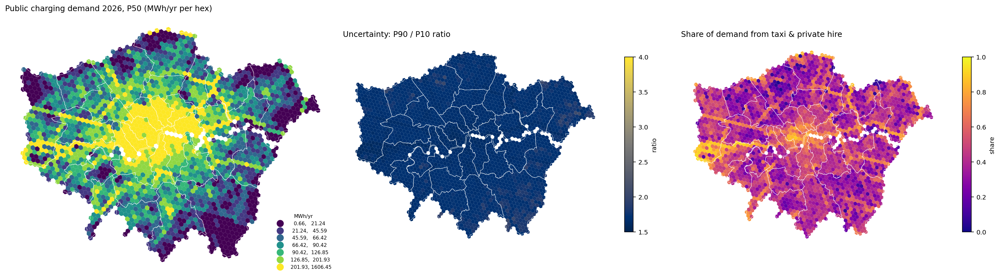
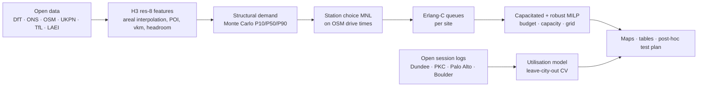

# ChargeScape London

**A spatial decision system for EV charging networks under uncertain demand.**
Where should the next public rapid-charging hubs in Greater London go, how many ports and what power, and how confident can we be — built end-to-end from open data, with every assumption visible.

[](https://github.com/OWNER/chargescape-london/actions) · Python 3.11+ · MIT

<p align="center"></p>

## Why this project

Public charging is an infrastructure business whose economics hinge on **utilisation**: a hub in the wrong hex idles at 5 %, the right one runs at 30 %+ with queues. Operators (EVgo, Allego, Yandex Electro) describe site selection as a demand model on dozens to hundreds of factors — but almost no public project (a) predicts *usage* rather than "where chargers already are", (b) carries uncertainty into the siting decision, (c) accounts for queues and cannibalisation, or (d) says how it would be proven wrong. ChargeScape does all four for London, on a laptop, from open sources.

## What it delivers

| Question | Answer in this repo | Notebook |
|---|---|---|
| Where are London's chargers relative to EV owners without driveways? | Supply audit with Moran's I / Gi* hot spots and network drive-time gap analysis | [01](notebooks/01_supply_audit.ipynb) |
| How much public energy will each 0.7 km² hex need, now and in 2030? | Structural Monte Carlo demand surface (P10/P50/P90) with a separate taxi & private-hire layer; DFES 2030 pathways | [02](notebooks/02_demand_surface.ipynb) |
| Which sites absorb the demand, and where do queues form? | Multinomial-logit station choice on OSM drive times + Erlang-C queues per site; incremental vs cannibalised demand for any candidate | [03](notebooks/03_choice_and_queues.ipynb) |
| Given a budget, where do the next 4 × 150 kW hubs go? | Capacitated maximal-covering MILP (HiGHS) with grid-headroom filter, plus a robust two-stage version over demand scenarios | [04](notebooks/04_siting.ipynb) |
| Do context features explain *observed* utilisation anywhere? | LightGBM on 204 chargers with open session logs (Dundee, Perth & Kinross, Palo Alto, Boulder): random vs leave-city-out CV, transfer to London | [05](notebooks/05_utilisation_transfer.ipynb) |

Interactive deck.gl maps (no API keys): [demand 2026](docs/maps/demand_2026.html) · [rapid network load & queues](docs/maps/rapid_network_load_2026.html) · [selected hubs, £20M](docs/maps/siting_hubs_budget_20m.html). Enable GitHub Pages on `/docs` to browse them.

## Headline numbers (Greater London, 2,374 H3 res-8 hexes)

| | Value | Source / status |
|---|---|---|
| Public chargers (1 Jul 2026) | 31,371, of which 2,533 (8.1 %) are 50 kW+ | DfT EVCI, observed |
| Plug-in cars kept in London (Mar 2026) | 300k; 177k private-kept, 120k company-kept; 63 % BEV | DfT VEH0145 by LSOA, observed |
| Public charging demand 2026 | **285 GWh/yr** P50 (P10–P90 216–362); near-home 78, destination 55, taxi & PHV 152 | structural model on observed inputs |
| Demand 2030 (DFES pathways) | 1,100 / 1,350 / 1,410 GWh/yr (low / mid / high) | model + UKPN DFES 2026 |
| Implied rapid sessions per charger per day | ≈13 — consistent with TfL's observed 34 % occupancy of rapid units and 38-min sessions | cross-check, notebook 02 |
| Rapid network today (366 sites, ports calibrated to DfT borough totals) | median 24 h utilisation 17 %; 174 sites with P(wait) > 0.5 at the peak hour | choice + queue model |
| New hubs, £20M budget | SITING_PLACEHOLDER | MILP, notebook 04 |

## How it works



Design choices that matter (full text in [`docs/methodology.md`](docs/methodology.md), assumptions and sensitivities in [`docs/model_card.md`](docs/model_card.md)):

* **Labels on every dataset** — `observed` / `proxy` / `synthetic` — in the [data catalog](docs/data_catalog/README.md) (23 sources) and in the results tables. Nothing synthetic is presented as observed.
* **Demand is modelled, then checked against observed aggregates** (DfT counts × TfL occupancy; Dundee per-charger throughput), because London publishes no charger-level usage.
* **Drive times, not buffers** — igraph shortest paths on the 131k-node OSM graph; the 2/5/10-minute logic operators actually use.
* **Supply calibrated to official totals** — OSM maps only ~15 % of London's rapid devices, so known sites' ports are scaled per borough to DfT's 50 kW+ counts (factor stored per site).
* **Uncertainty reaches the decision** — the robust MILP picks one set of hubs that performs across P10/P50/P90; the overlap with the P50 solution tells you which sites are safe and which depend on the optimistic tail.
* **Spatial cross-validation by default** — random K-fold is shown only to demonstrate its optimism.

## Reproduce

```bash
git clone https://github.com/OWNER/chargescape-london && cd chargescape-london
pip install -e ".[dev]"
make data        # ~3.5 GB raw: Census, DfT, OSM PBF, UKPN, LAEI, open session logs (idempotent)
make features    # H3 feature table → data/processed/hex_features_r8.small.parquet (committed)
make models      # demand → allocation/queues → siting (≈15 min on a laptop, HiGHS)
make maps        # deck.gl HTML → docs/maps/
python scripts/make_notebooks.py && jupyter nbconvert --execute --inplace notebooks/*.ipynb
```

Small processed tables (`data/processed/*.small.parquet`) are committed, so notebooks 02–05 run without downloading raw data. Optional: set `OCM_API_KEY` to pull Open Charge Map instead of relying on the borough calibration.

## Repository layout

```
src/chargescape/
  data/        one module per source: census, vehicles, chargepoints, osm, transit, traffic, weather, ukpn, sessions_open
  features/    grid (H3, areal interpolation), supply, context (LAEI vkm, DFES, headroom), accessibility & travel_time (igraph), spatial_stats, station_context, build
  models/      structural_demand (Monte Carlo), demand_pipeline, choice (MNL), queueing (Erlang C), allocation_pipeline, ml (spatial CV, quantile LightGBM)
  optimize/    facility (sparse HiGHS MILP: capacitated, robust, greedy), siting_pipeline
  viz/         figures (matplotlib), maps (pydeck), export_maps
docs/          methodology, model card, data catalog (one card per source), roadmap, maps/
notebooks/     01–05, generated by scripts/make_notebooks.py and executed
tests/         16 unit tests (queues vs closed forms, choice, MILP on toy instances, grid, spatial CV)
```

## Limitations, honestly

* No open London charger-level usage; behaviour comes from other UK cities and fleet trials (Optimise Prime, Low Carbon London).
* OSM's hub bias and the 2021 registry snapshot mean unmapped rapid devices are represented by port scaling, not exact positions.
* Choice-model coefficients are literature-informed, not estimated; their effect on the siting result is reported, not hidden.
* Grid constraints stop at primary-substation headroom (secondary data need a UKPN account).
* Area-weighted interpolation from LSOAs; ≈1.4 % of population sits in edge hexes dropped by centroid selection.

## How this would be proven wrong

DfT/Zapmap publish borough device counts quarterly; TfL publishes utilisation by charger type. Hubs opened after July 2026 in hexes flagged here as high unmet demand should reach above-median utilisation within a year. If they do not, the priors that need revisiting are named in the model card (taxi/PHV fleet size, public share without home charging, choice radius). That loop — predict, deploy, measure, retrain — is the product; the maps are its interface.

## Roadmap

Revealed-preference calibration of the choice model, Open Charge Map with a key, dasymetric interpolation, spatio-temporal occupancy forecasting on UrbanEV / Paris Belib', a post-hoc validation notebook, and a second track for pedestrian-demand networks. Details in [`docs/roadmap.md`](docs/roadmap.md).

## Licences and attribution

Code MIT. Data: DfT, ONS, UKPN DFES/headroom mirrors and LAEI under OGL v3 / CC BY 4.0; OpenStreetMap © contributors, ODbL; TfL and NaPTAN "Powered by TfL Open Data" (OGL); Dundee and Perth & Kinross councils (OGL); City of Palo Alto (PDDL); City of Boulder (CC0); Paris Belib' (ODbL); WorldPop (CC BY 4.0); Open-Meteo (CC BY 4.0). Per-source cards list exact terms.

*Author: Marija Ercegovac — urban planner turned geospatial data scientist. Built as a portfolio project in September 2026; questions and pull requests welcome.*
