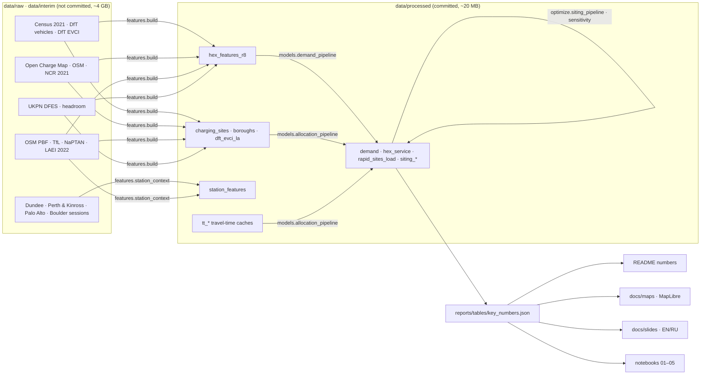

# Architecture and stack

How the code is organised, why each tool was chosen over the obvious alternative, and what it costs to run.

## Data flow

The split between `interim` and `processed` is the reproducibility contract: everything downstream of the feature build reads only committed, compact tables, so `make models report maps slides notebooks` runs from a fresh clone without any download. Only `make data features` needs the raw sources.

## Module map

| Module | Responsibility | Reads → writes |
|---|---|---|
| `chargescape.data.*` | one module per source; idempotent download + tidy parquet; each has a card in `docs/data_catalog/` | internet → `data/raw`, `data/interim` |
| `features.grid` | H3 grid, area-weighted interpolation (extensive / intensive), k-ring neighbours | geometries → hex tables |
| `features.supply` | merge Open Charge Map, OSM and NCR 2021; 50 m de-duplication with source priority; rapid/slow split | interim → `charging_sites.small.parquet` |
| `features.context` | LAEI vehicle-km per hex (cars, taxi, PHV), DFES 2030 EV stock, primary-substation headroom | interim → hex columns |
| `features.accessibility`, `features.travel_time` | igraph many-to-many Dijkstra on the OSM drive graph; signature-checked caches | graph → `tt_*.npz` |
| `features.station_context` | OSM POIs within 300/800 m, distance to roads and rail, WorldPop within 1 km, session targets | → `station_features.small.parquet` |
| `features.build` | assembles the 81-column hex table and the compact reference copies | → `hex_features_r8.small.parquet` |
| `models.structural_demand` | bottom-up public-charging energy with triangular priors, Monte Carlo P10/P50/P90 | pure function |
| `models.demand_pipeline` | attraction mix, company-kept EVs, taxi/PHV layer, DFES 2030 pathways | → `demand_r8.small.parquet` |
| `models.choice` | multinomial logit utilities, stable softmax with outside option, incremental vs cannibalised demand | pure functions |
| `models.queueing` | Erlang C: utilisation, P(wait), mean wait, ports for a service level | pure functions |
| `models.allocation_pipeline` | choice + queues on today's rapid network, borough calibration of ports, candidate cannibalisation | → `hex_service`, `rapid_sites_load` |
| `optimize.facility` | sparse capacitated MCLP (SciPy / HiGHS), exact fixed-plan evaluation LP, greedy baseline; a two-stage robust MCLP kept for small instances (it does not close its gap on London) | pure functions |
| `optimize.siting_pipeline` | candidates, unmet demand, hub capacity from Erlang C, budget sweep; plan per demand scenario, cross-evaluation, regret, robust core | → `siting_*`, `reports/tables` |
| `optimize.sensitivity` | re-solves at £20M under changed behavioural and service assumptions | → `reports/tables/sensitivity_*.csv` |
| `models.ml`, `features.spatial_stats` | spatial CV, quantile LightGBM, Moran's I, Gi*, LISA | pure functions |
| `viz.figures`, `viz.export_maplibre` | matplotlib figures; MapLibre GL pages with embedded data | → `reports/figures`, `docs/maps` |
| `scripts/*` | key numbers, README numbers, data catalog index, notebooks, HTML and PPTX decks | → `README.md`, `docs/`, `reports/` |

## Stack, and why

| Layer | Choice | Why this and not the obvious alternative |
|---|---|---|
| Spatial unit | **H3 resolution 8** (0.74 km²), resolution 9 for sensitivity | Equal-area cells with six neighbours make spatial lags, catchments and optimisation indices trivial; LSOAs (census units) vary 50-fold in area and are used only as input. |
| Road network | **OSMnx + igraph** | A routing server (OSRM, Valhalla) needs Docker and a build step. igraph's C Dijkstra on the 131k-node, 304k-edge London drive graph gives the 2,374 × 632 hex-to-site matrix in seconds, and the result is cached with a signature of its inputs. |
| Demand | **Structural Monte Carlo** | No charger-level usage is published for London, so a supervised model would learn where chargers already are. A structural model makes every assumption a named prior, produces intervals, and is checked against observed aggregates. |
| Choice | **Multinomial logit** with an outside option | Equivalent to a calibrated Huff model, but the outside option separates new demand from demand taken from existing sites. |
| Queues | **Erlang C** (M/M/c) | Closed form, vectorised over 632 sites, unit-tested against M/M/1. Discrete-event simulation with empirical service times is the natural upgrade. |
| Optimisation | **`scipy.optimize.milp` / `linprog` (HiGHS)** | No external solver licence or binary. The model is built as a sparse matrix; adding the linking constraints yij ≤ xj tightened the LP relaxation so the £10M instance went from a 20-second time-out to a proven optimum in 4.6 s. Every solve records its MIP gap — which is how a two-stage robust formulation was caught returning an unusable incumbent and replaced by exact scenario cross-evaluation. |
| ML | **LightGBM + spatial CV** | Strong tabular baseline with quantile objectives; leave-group-out CV is the default because random folds overstate skill on autocorrelated data. |
| Spatial statistics | **esda / libpysal** | Reference implementations of Moran's I, Getis-Ord Gi* and LISA with permutation inference. |
| Maps | **MapLibre GL JS 4.7** (vendored) | Open-source, no token, WebGL extrusions and data-driven styling. Data is embedded as JS so the pages also work from disk, and they fall back to a plain background when the basemap is unreachable. |
| Delivery | **GitHub Pages** (static) | Nothing to keep running: maps, slides and notebooks stay available as long as the repository does. |
| Quality | **pytest, ruff, GitHub Actions** | Unit tests against closed forms and toy instances; CI lints, tests and smoke-runs the models on the committed tables on Python 3.11 and 3.12. |

## Cost to run (laptop, Apple Silicon)

| Step | Time |
|---|---|
| `make data` (first run, ~4 GB) | ~40 min, network-bound |
| `make features` | ~1 min (hex table 3 s; London station context the rest) |
| demand Monte Carlo (500 draws × 4 scenarios) | ~10 s |
| choice + queues on 632 sites | ~30 s |
| siting sweep, 4 budgets × 3 scenario plans + cross-evaluation | a few minutes |
| sensitivity, 10 variants at £20M | ~20 min |
| notebooks 01–05 | ~3 min |

## Testing

`tests/` covers the parts where a silent error would change a decision: Erlang C against the M/M/1 closed form and stability limits; logit probabilities, the choice-set cut-off and the new-vs-cannibalised identity; the MILP on toy instances where the optimum is known (budget, capacity and robust cases); area-weighted interpolation conserving mass; Monte Carlo quantiles ordered and monotone in EV stock; Moran's I detecting a gradient and not noise; three-source de-duplication; the travel-time cache rejecting stale inputs; hub capacity growing with ports and tolerated wait; map legend and style expressions.
